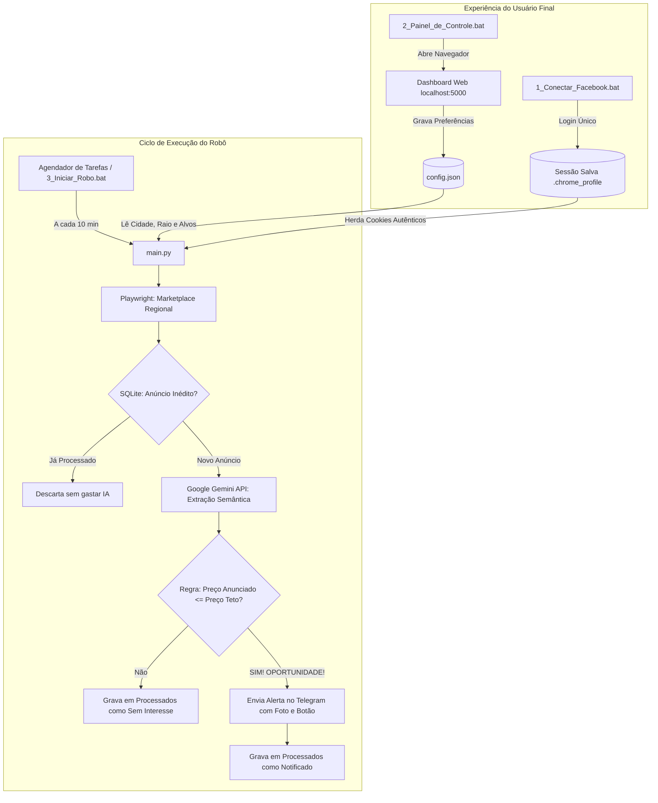

# Arquitetura do Sistema e Decisões Técnicas (Edição Comercial)

Este documento descreve a arquitetura do **Robô do Brick**, os fluxos de dados, o ciclo de vida de cada execução e o modelo de produto comercial projetado para operação simples de **2 botões**.

---

## 🏗️ Visão Geral da Arquitetura

O sistema é dividido em duas camadas desacopladas:
1. **Camada de Gestão (Dashboard Web sob Demanda):** Permite ao usuário final configurar cidades, alvos de compra, limites de preço e notificações sem tocar em arquivos de código. Fica ativo apenas enquanto o usuário estiver configurando.
2. **Camada de Execução (Batch Scraper):** Script leve em Python disparado a cada 10 minutos pelo sistema operacional, que lê a configuração, raspa os anúncios, filtra oportunidades via IA, notifica no Telegram e se encerra em ~30 segundos.

### Diagrama de Fluxo Ponta a Ponta

---

## 🔬 Componentes da Arquitetura Comercial

### 1. Centralizador de Configuração: `config.json`
* **Conceito:** Elimina variáveis de ambiente espalhadas e comandos SQL manuais.
* **Estrutura:** Um único arquivo JSON estruturado contendo localização, tabela de alvos, chaves de API e preferências de execução.
* **Sincronização:** Quando o Dashboard é salvo, ele regrava o `config.json` e sincroniza automaticamente a tabela de alvos no banco de dados SQLite.

### 2. Motor de Localização Dinâmica (Sem URLs Manuais)
* O cliente não precisa saber construir URLs de busca do Facebook.
* O robô normaliza o nome da cidade (ex: `"São Paulo"` ➔ `"saopaulo"`, `"Rio de Janeiro"` ➔ `"rio"`) e concatena os filtros de categoria e ordenação para gerar URLs canônicas automáticas.

### 3. Painel de Controle Web Local (Dashboard)
* **Tecnologia:** Microframework Flask nativo, servindo HTML/CSS/JS de alto padrão estético (Dark Mode / Glassmorphism).
* **Consumo de Recursos:** Não consome RAM constante. O servidor só roda enquanto a janela do painel estiver aberta pelo usuário.
* **Funcionalidades:**
  * Cadastro e exclusão visual de produtos alvos.
  * Ajuste de preço teto e estimativa de margem de lucro.
  * Botão de teste para disparar mensagem imediata no Telegram.
  * Visualização de oportunidades capturadas anteriormente.

### 4. Perfil Isolado do Navegador (`.chrome_profile`)
* **Privacidade Absoluta:** O usuário digita suas credenciais diretamente no Facebook. Nenhuma credencial é interceptada pelo software.
* **Zero Conflito:** Como o robô roda em uma pasta de perfil dedicada (`.chrome_profile`), o cliente pode usar o Google Chrome principal normalmente sem sofrer com bloqueios de arquivo (`SingletonLock`).

### 5. Motor de Extração e Inteligência Artificial
* **Playwright Chromium:** Execução em modo invisível (*headless*), com manipulação suave do DOM para descarte de modais de convite.
* **Google Gemini API (Free Tier):** Trata textos coloquiais, detecta pegadinhas e avarias ("tela trincada", "sem face id") e valida se o produto corresponde exatamente ao modelo desejado.
* **Telegram Bot API:** Entrega o alerta de forma imediata no smartphone do comprador.
