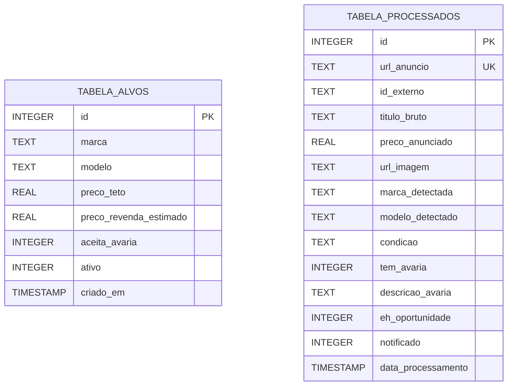

# Modelagem do Banco de Dados (SQLite)

O **Robô do Brick** utiliza o **SQLite** como motor de banco de dados embutido. Ele reside em um único arquivo local (`bric_hunter.db`), dispensando servidores ativos, portas abertas e consumo de memória RAM quando inativo.

---

## 🗄️ Esquema Relacional

O banco é estruturado em duas tabelas principais:
1. **`tabela_alvos`**: Catálogo de aparelhos que o usuário deseja comprar, contendo o teto máximo de pagamento e parâmetros de margem.
2. **`tabela_processados`**: Registro histórico de anúncios já raspados e avaliados, garantindo deduplicação estrita para evitar alertas repetidos e chamadas desnecessárias de IA.



---

## 📜 Definição DDL (SQL)

Abaixo está o script SQL completo para criação das tabelas e índices de alta performance:

```sql
-- Ativação do modo Write-Ahead Logging (WAL) para leituras e escritas concorrentes rápidas
PRAGMA journal_mode = WAL;
PRAGMA synchronous = NORMAL;

-- 1. TABELA DE ALVOS (Produtos Monitorados)
CREATE TABLE IF NOT EXISTS tabela_alvos (
    id INTEGER PRIMARY KEY AUTOINCREMENT,
    marca TEXT NOT NULL,                         -- Ex: 'Apple', 'Xiaomi', 'Samsung'
    modelo TEXT NOT NULL,                        -- Ex: 'iPhone 13', 'Poco X6 Pro', 'Galaxy S23'
    preco_teto REAL NOT NULL,                    -- Valor máximo que você aceita pagar
    preco_revenda_estimado REAL DEFAULT 0.0,     -- Valor médio de revenda no mercado local
    aceita_avaria INTEGER DEFAULT 0,             -- 0 = Não, 1 = Sim (ex: telas trincadas para conserto)
    ativo INTEGER DEFAULT 1,                     -- 0 = Pausado, 1 = Monitorando
    criado_em TIMESTAMP DEFAULT CURRENT_TIMESTAMP,
    atualizado_em TIMESTAMP DEFAULT CURRENT_TIMESTAMP
);

-- Índice para busca rápida de alvos ativos por modelo
CREATE INDEX IF NOT EXISTS idx_alvos_modelo_ativo 
ON tabela_alvos(modelo, ativo);


-- 2. TABELA DE PROCESSADOS (Histórico e Deduplicação)
CREATE TABLE IF NOT EXISTS tabela_processados (
    id INTEGER PRIMARY KEY AUTOINCREMENT,
    url_anuncio TEXT UNIQUE NOT NULL,            -- URL canônica (chave de deduplicação)
    id_externo TEXT,                             -- ID do anúncio no Marketplace (se disponível)
    titulo_bruto TEXT NOT NULL,                  -- Texto cru coletado no anúncio
    preco_anunciado REAL NOT NULL,               -- Valor em R$ raspado da página
    url_imagem TEXT,                             -- Link da foto do produto para envio no Telegram
    marca_detectada TEXT,                        -- Normalizado pelo Gemini
    modelo_detectado TEXT,                       -- Normalizado pelo Gemini
    condicao TEXT,                               -- Ex: 'novo', 'usado', 'com_defeito'
    tem_avaria INTEGER DEFAULT 0,                -- 0 = Não, 1 = Sim
    descricao_avaria TEXT,                       -- Detalhes extraídos pelo Gemini
    eh_oportunidade INTEGER DEFAULT 0,           -- 1 = Preço <= Teto e atende critérios
    notificado INTEGER DEFAULT 0,                -- 1 = Alerta enviado com sucesso no Telegram
    data_processamento TIMESTAMP DEFAULT CURRENT_TIMESTAMP
);

-- Índice de alta performance para checagem imediata de duplicatas (O(1))
CREATE UNIQUE INDEX IF NOT EXISTS idx_processados_url 
ON tabela_processados(url_anuncio);

CREATE INDEX IF NOT EXISTS idx_processados_data 
ON tabela_processados(data_processamento);
```

---

## 🎯 Carga Inicial de Dados (Seed de Exemplo)

Exemplo de alvos pré-configurados com teto de compra e valor médio de revenda estimado para arbitragem rápida:

```sql
INSERT INTO tabela_alvos (marca, modelo, preco_teto, preco_revenda_estimado, aceita_avaria) VALUES
('Xiaomi', 'Poco X6 Pro', 1400.00, 1900.00, 0),
('Xiaomi', 'Poco X5 Pro', 1000.00, 1400.00, 0),
('Apple', 'iPhone 11', 1100.00, 1600.00, 0),
('Apple', 'iPhone 12', 1600.00, 2200.00, 0),
('Apple', 'iPhone 13', 2200.00, 2900.00, 0),
('Samsung', 'Galaxy S21 FE', 950.00, 1350.00, 0),
('Samsung', 'Galaxy S23', 1900.00, 2600.00, 0),
('Sony', 'PlayStation 5', 2300.00, 3100.00, 0);
```

---

## 🐍 Exemplo de Integração em Python

Módulo de acesso ao banco (`database.py`):

```python
import sqlite3
from typing import Optional, List, Dict, Any

DB_PATH = "bric_hunter.db"

def get_connection() -> sqlite3.Connection:
    conn = sqlite3.connect(DB_PATH)
    conn.row_factory = sqlite3.Row
    return conn

def is_anuncio_processado(url_anuncio: str) -> bool:
    """Verifica em tempo O(1) se a URL já foi raspada anteriormente."""
    with get_connection() as conn:
        cursor = conn.cursor()
        cursor.execute("SELECT 1 FROM tabela_processados WHERE url_anuncio = ? LIMIT 1", (url_anuncio,))
        return cursor.fetchone() is not None

def registrar_anuncio(
    url_anuncio: str,
    titulo_bruto: str,
    preco_anunciado: float,
    url_imagem: str,
    dados_gemini: Optional[Dict[str, Any]] = None,
    eh_oportunidade: bool = False,
    notificado: bool = False
) -> None:
    """Insere o anúncio no histórico de processados."""
    marca = dados_gemini.get("marca") if dados_gemini else None
    modelo = dados_gemini.get("modelo") if dados_gemini else None
    condicao = dados_gemini.get("condicao") if dados_gemini else None
    tem_avaria = 1 if (dados_gemini and dados_gemini.get("tem_avaria")) else 0
    descricao_avaria = dados_gemini.get("descricao_avaria") if dados_gemini else None

    with get_connection() as conn:
        cursor = conn.cursor()
        cursor.execute("""
            INSERT OR IGNORE INTO tabela_processados (
                url_anuncio, titulo_bruto, preco_anunciado, url_imagem,
                marca_detectada, modelo_detectado, condicao, tem_avaria,
                descricao_avaria, eh_oportunidade, notificado
            ) VALUES (?, ?, ?, ?, ?, ?, ?, ?, ?, ?, ?)
        """, (
            url_anuncio, titulo_bruto, preco_anunciado, url_imagem,
            marca, modelo, condicao, tem_avaria,
            descricao_avaria, 1 if eh_oportunidade else 0, 1 if notificado else 0
        ))
        conn.commit()

def buscar_alvos_ativos() -> List[Dict[str, Any]]:
    """Retorna todos os alvos ativos para conferência de regras."""
    with get_connection() as conn:
        cursor = conn.cursor()
        cursor.execute("SELECT * FROM tabela_alvos WHERE ativo = 1")
        return [dict(row) for row in cursor.fetchall()]
```

---

## 🧹 Manutenção e Limpeza Periódica

Para garantir que o arquivo `bric_hunter.db` continue pesando apenas alguns megabytes após meses de uso:

```sql
-- Deletar anúncios que não foram oportunidades e que foram processados há mais de 45 dias
DELETE FROM tabela_processados 
WHERE eh_oportunidade = 0 
  AND data_processamento < datetime('now', '-45 days');

-- Compactar o banco de dados liberando espaço em disco
VACUUM;
```
